<div align="center">

# 〰 Rhythm

### The AI-assisted perfume studio

**Compose a fragrance that has never existed.** Tell Rhythm the notes you love and how you want to feel. It remixes time-tested accords into new formulas, then shows you how each one will open, unfold and fade on skin.


[Features](#features) · [Screenshots](#a-tour-of-the-studio) · [How it works](#how-the-engine-works) · [Tech stack](#tech-stack) · [Getting started](#getting-started)

<br>

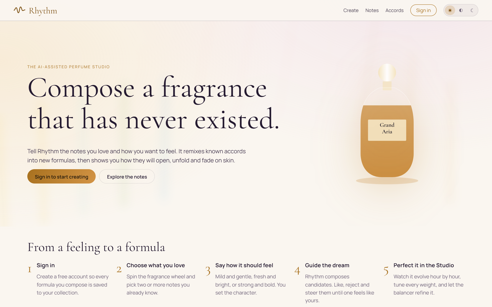

</div>

---

## What is Rhythm?

Accords are the building blocks of every fragrance. Rhythm is a web app that learns how notes and accords combine, then guides you from a feeling to a finished, balanced formula. You stay in charge: you choose the notes, set the character, react to what it dreams up and fine-tune every dose.

Inspired by the idea behind [Deep Dream Generator](https://deepdreamgenerator.com), Rhythm treats perfume creation as a conversation between a person's taste and a generative engine.

## Features

| | |
| --- | --- |
| 🎡 **Fragrance wheel** | Pick two or more notes you already love from an interactive wheel of 12 olfactive families and 110 notes. |
| ✨ **Dream generations** | Rhythm composes four candidate perfumes at a time. Steer them (fresher, warmer, softer…), like or reject them, and each new generation reshapes itself around your taste. |
| ⏱ **Formula Studio** | The heart of Rhythm. Watch your perfume evolve hour by hour on skin, with a live timeline, harmony and structure scores and a note pyramid. |
| 🌬 **Sillage and projection** | Original visualisations show how far the scent trail reaches and how it projects at conversation distance, at any moment of the day. |
| ⚖️ **Score coach and balancer** | One-tap suggestions swap, add or re-dose notes, with indicative IFRA limits enforced on everything. |
| 🧑‍🔬 **AI perfumer** | Ask an LLM perfumer to critique your formula and propose exact dose changes. Nothing changes until you apply them. |
| 🧪 **Lab bench** | Notes are grouped into the accords they form, weighed from your own stock dilutions, with a printable lab sheet for any batch size. |
| 🍾 **Identity and packaging** | AI-assisted names, stories, bottle shapes, colours, caps and boxes, rendered live as you design. |
| 📚 **Notes and accords catalogue** | Every note has performance metrics, use levels, pairings and the accords and well-known perfumes it appears in. |
| 🔐 **Accounts and admin** | Sign in with Google, Apple or email. An admin portal manages users, formulas and catalogue imports. |
| 🔑 **Bring your own AI** | Users can plug in their own Claude key or any OpenAI-compatible server, encrypted at rest. |
| 🌗 **Light and dark themes** | Designed for both, with a device-matching default. Installable and cached for fast repeat visits. |

## A tour of the studio

### 1. Choose the notes you love

Spin the fragrance wheel or search the catalogue. Hover any note for its profile, performance and best partners.

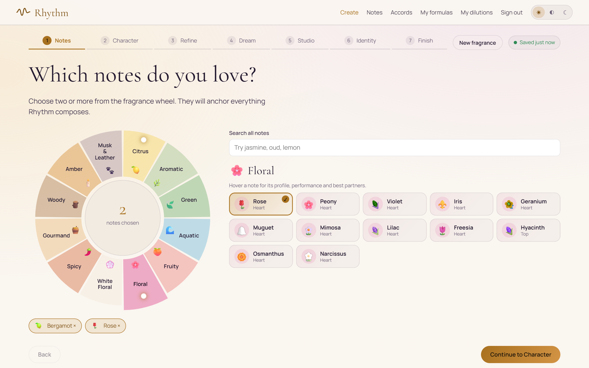

### 2. Guide the dream

Rhythm builds four compositions around your brief. Every steer pushes the next generation further in that direction.

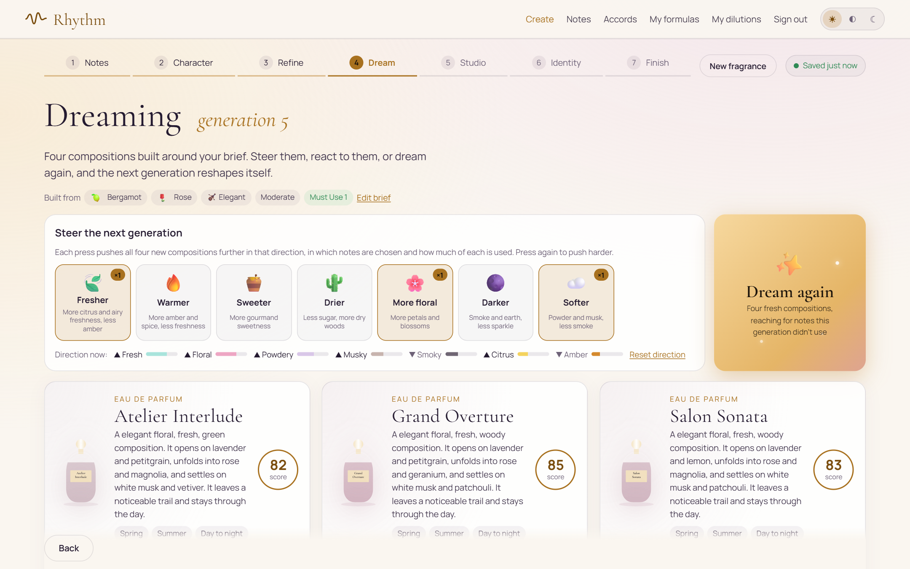

### 3. Perfect it in the Formula Studio

See the day on skin before you mix a drop. Each band is a note, sized by how strongly you smell it from the first spray to the last trace.

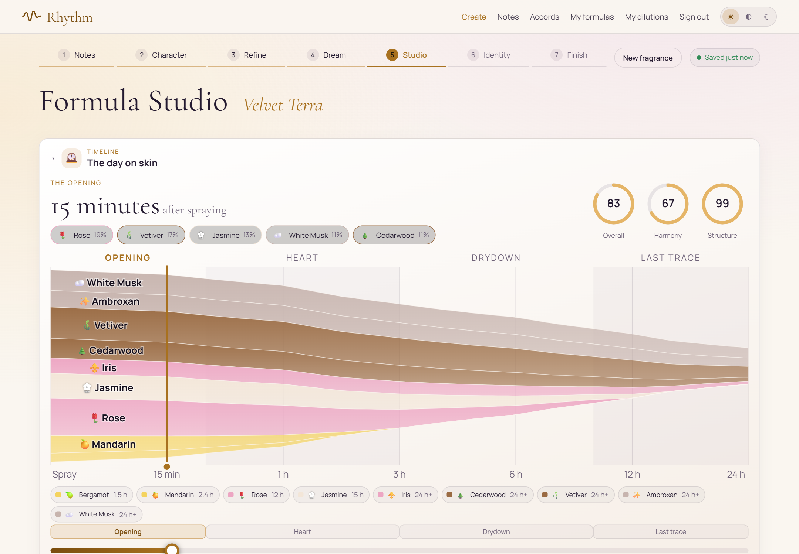

<table>
<tr>
<td width="50%">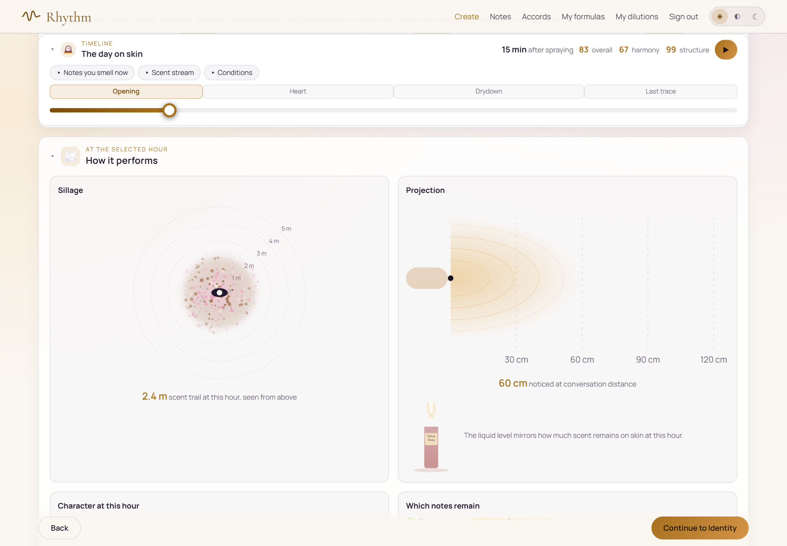<p align="center"><sub><b>Sillage and projection</b> at the selected hour</sub></p></td>
<td width="50%">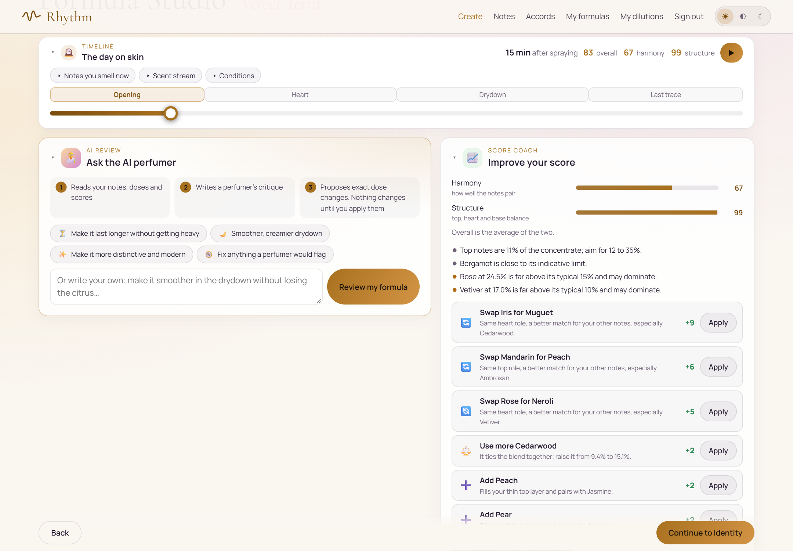<p align="center"><sub><b>AI perfumer and score coach</b> with one-tap fixes</sub></p></td>
</tr>
<tr>
<td width="50%">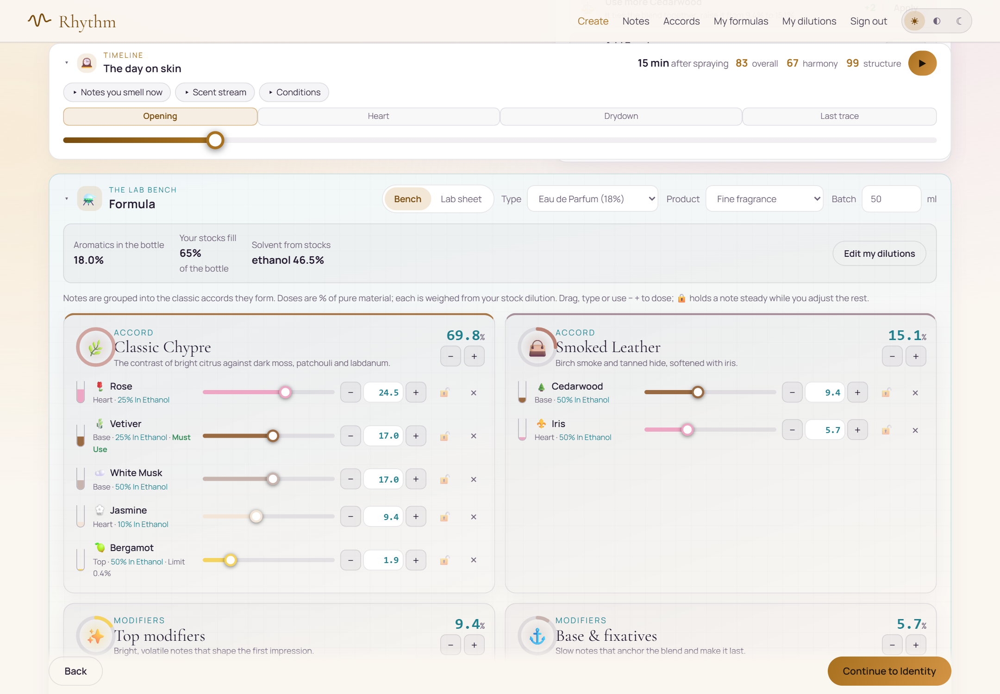<p align="center"><sub><b>Lab bench</b>: doses grouped by accord, weighed from your dilutions</sub></p></td>
<td width="50%">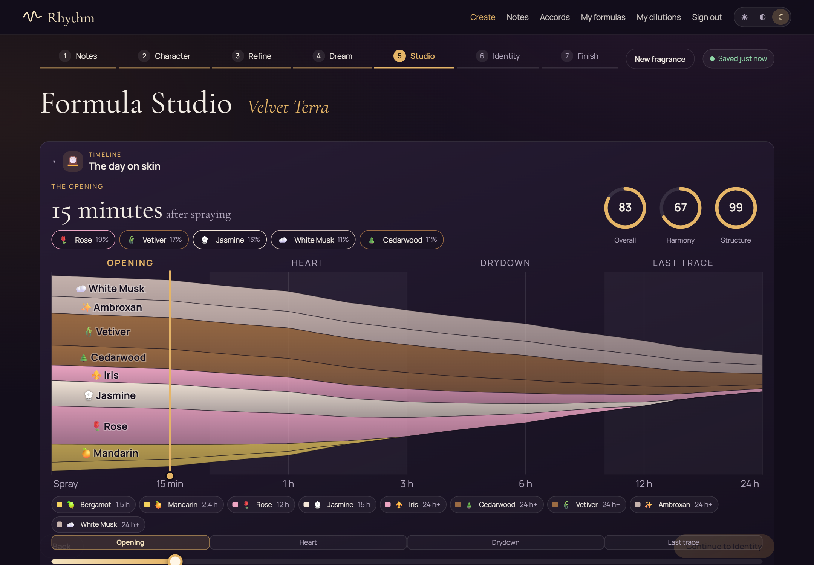<p align="center"><sub><b>Dark theme</b></sub></p></td>
</tr>
</table>

### 4. Give it an identity

Pick a concept, then fine-tune the name, bottle, colours, packaging and concentration.

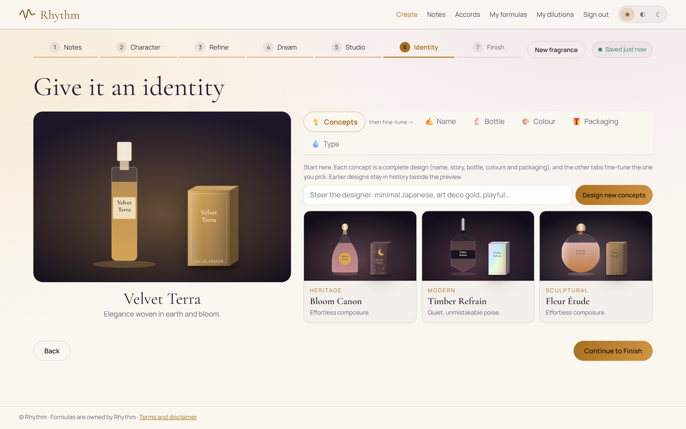

### 5. Explore the catalogue

<table>
<tr>
<td width="50%">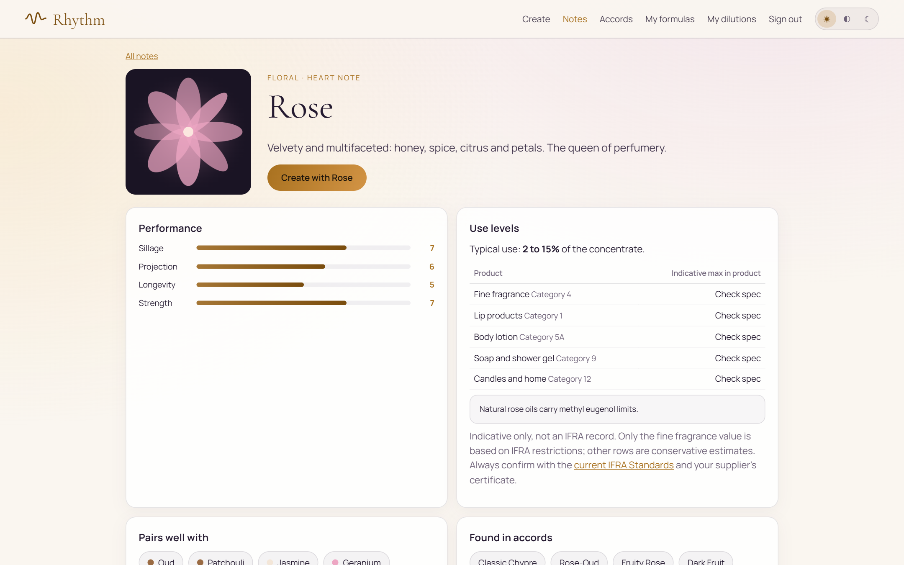<p align="center"><sub><b>Note detail</b>: performance, use levels and pairings</sub></p></td>
<td width="50%">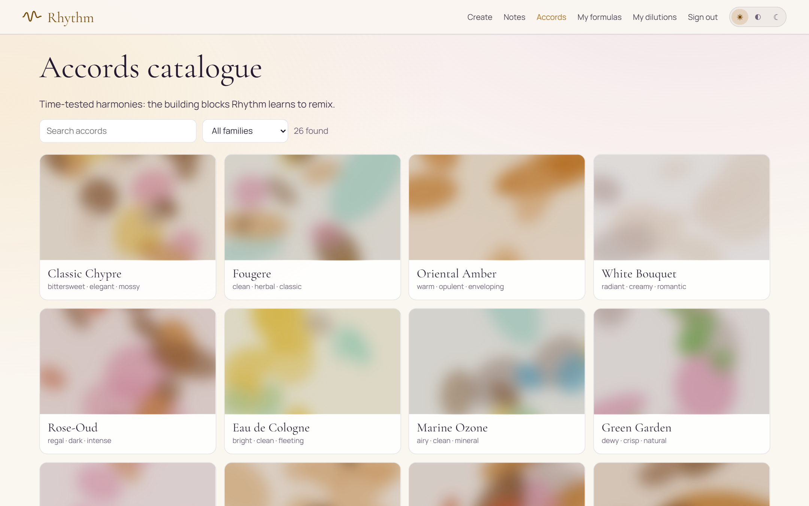<p align="center"><sub><b>Accords catalogue</b> with generated artwork</sub></p></td>
</tr>
</table>

## How the engine works

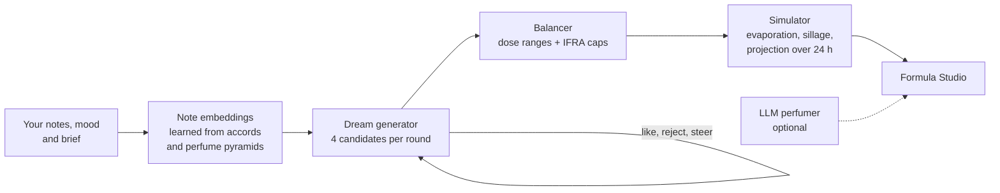

- **Training.** `npm run train` builds a note co-occurrence matrix over the corpus, applies PPMI and factorises it into 24-dimension note embeddings in `shared/generated/model.json`.
- **Generation.** Runs entirely in the browser. Notes are chosen by learned affinity, mood, brief and the user's taste profile.
- **Balancing.** The balancer enforces typical dose ranges and indicative IFRA limits on every formula, including those proposed by the LLM.
- **Simulation.** Each note's volatility, strength and dose drive the timeline, sillage, projection and "which notes remain" views.
- **LLM layer.** A self-hosted OpenAI-compatible model (or Claude) powers the AI perfumer and brand concepts. Replies are schema-validated, and the built-in engine answers if the model is unavailable.
- **Artwork.** Note, accord and bottle art is generated procedurally in the browser, not by an image model.

The corpus in `shared/data/` is original and hand-authored. Nothing was scraped, and no proprietary formulas are included.

## Tech stack

| Layer | Technology |
| --- | --- |
| Frontend | React 19, React Router 7, Vite 8, TypeScript |
| API | [Hono](https://hono.dev) on Cloudflare Pages Functions |
| Database | Cloudflare D1 (SQLite), with migrations in `migrations/` |
| AI | Self-hosted OpenAI-compatible LLM or Claude, with an in-browser generative engine |
| Auth | Email and password, Google and Apple sign-in |
| Validation | Zod |
| Testing | Vitest |
| Caching | Immutable hashed assets, a service worker and edge-cached public API responses |

Every library is free and open source. The LLM layer is optional.

## Project structure

```
├── src/                  React app
│   ├── pages/            Home, Create wizard, Catalogue, Account, Dilutions, Admin, Terms
│   └── components/       Studio, Wheel, Dream, Bench, Identity, Bottle, visualisations
├── server/               Hono API: auth, AI, user AI keys, admin
├── shared/
│   ├── engine/           Generation, balancing, simulation, branding, dilution
│   ├── data/             Notes, accords and perfume pyramids
│   └── generated/        Trained note embeddings
├── functions/            Cloudflare Pages Functions entry
├── migrations/           D1 schema
├── scripts/train.ts      Model training
└── tests/                Engine and API tests
```

## Getting started

Requires **Node 24**.

```bash
npm install
```

```bash
cp .dev.vars.example .dev.vars
```

```bash
npm run pages:dev
```

Open <http://localhost:8788>. The command builds the app, applies database migrations locally and serves the app and API together.

```bash
npm test
```

Every secret is optional: features without their keys are hidden or fall back to the built-in engine. See **[docs/SETUP.md](docs/SETUP.md)** for configuring sign-in providers, the AI layer, the admin account and deploying to Cloudflare Pages.

## Disclaimer

Formulas created on Rhythm, and everything created with them, are fully owned by Rhythm and its owners. No one may claim trademarks, copyrights or other rights in them. See the in-app **Terms and disclaimer**.

Performance figures are modelled estimates, and IFRA figures are indicative only. Always verify against the current [IFRA Standards](https://ifrafragrance.org/) and your supplier's certificates before making or selling a fragrance.

<div align="center">
<br>
<sub>Made with care for perfumers, dreamers and the curious.</sub>
</div>
